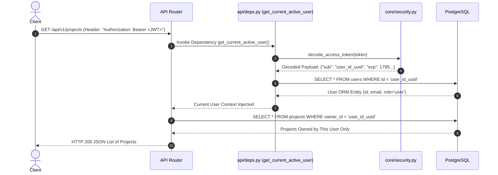

# Codebase File Structure & Inter-Module Data Flow

This document details the exact repository file tree, the responsibilities of each module, and the step-by-step data contracts and schemas transferred across files during runtime.

---

## 1. Annotated Repository Tree

```
c:\Users\Dell\Desktop\Rag application\
├── api/                                # REST API Subsystem (FastAPI)
│   ├── deps.py                         # Dependency injection (JWT token extraction, current active user)
│   ├── main.py                         # FastAPI application entrypoint, middleware, and route mounting
│   ├── schemas.py                      # Pydantic request and response data models
│   └── routers/                        # API Endpoint Route Controllers
│       ├── auth.py                     # User registration, login, and profile (/api/v1/auth)
│       ├── chat.py                     # Conversational RAG queries & message histories (/api/v1/projects/{id}/chat)
│       ├── documents.py                # Async document upload, status polling & deletion (/api/v1/projects/{id}/documents)
│       └── projects.py                 # Multi-tenant project workspace management (/api/v1/projects)
│
├── core/                               # Core Engine & Business Logic
│   ├── chat_manager.py                 # Conversation management & session persistence
│   ├── chunker.py                      # Semantic title-aware chunking & metadata propagation
│   ├── config.py                       # Global settings, environment variables, model names, and thresholds
│   ├── limiter.py                      # SlowAPI rate limiting configuration and key generators
│   ├── logger.py                       # Unified structured logging across ingestion, retrieval & generation
│   ├── parser.py                       # Unstructured document partitioning (PDF, DOCX, CSV, TXT, MD)
│   ├── pipeline.py                     # Document ingestion pipeline orchestrator (Stages 1 to 5)
│   ├── projects.py                     # Project workspace metadata operations & directory management
│   ├── rag_chain.py                    # RAG chain controller, greeting interceptor & OpenAI generator
│   ├── retriever.py                    # HybridRetriever (Dense pgvector + Sparse BM25 + RRF + Cohere)
│   ├── security.py                     # Bcrypt password hashing & stateless JWT encode/decode
│   ├── summarizer.py                   # Multimodal table and image LLM summarisation
│   ├── users.py                        # User authentication, credential validation & persistence
│   └── vectorstore.py                  # PostgreSQL (pgvector) vector store client & embedding generator
│
├── db/                                 # Persistence Subsystem (PostgreSQL & SQLAlchemy)
│   ├── base.py                         # DeclarativeBase foundation
│   ├── database.py                     # Engine initialization & metadata hooks
│   ├── models.py                       # SQLAlchemy ORM models (User, Project, Document, DocumentChunk, etc.)
│   ├── session.py                      # Database connection pooling, sessionmaker & retry health checks
│   └── alembic/                        # Database schema migrations
│       ├── env.py                      # Alembic runtime environment
│       └── versions/                   # Migration revision scripts (001_initial, 002_retrio_core_schema)
│
├── docs/                               # Engineering Handover Documentation Suite
│   ├── README.md                       # Documentation hub & quickstart
│   ├── WORKFLOW_AND_ARCHITECTURE.md    # Architecture blueprints & flowcharts
│   ├── FILE_STRUCTURE_AND_DATA_FLOW.md # File tree & inter-module data schemas (This File)
│   ├── CLI_SCRIPTS_REFERENCE.md        # Command-line tools & flag reference
│   └── API_REFERENCE_AND_CURLS.md      # REST API endpoints & copy-paste cURL commands
│
├── scripts/                            # Operational Tools, Benchmarks & Standalone CLI Utilities
│   ├── chunk_document.py               # Standalone document parser & title chunker CLI
│   ├── embed_document.py               # Standalone chunk vectorizer & pgvector inserter CLI
│   ├── retrieve_context.py             # Standalone Hybrid + Cohere context retrieval CLI
│   ├── evaluate_accuracy.py            # Precision, Recall & Regression evaluation runner
│   ├── run_rag_benchmark.py            # Full RAG benchmark suite (HitRate, MRR, nDCG, MAP, Noise Rate)
│   ├── test_background_ingest_and_greeting.py # Async ingestion & greeting interception test suite
│   ├── test_security_rbac.py           # Multi-tenant isolation & rate-limiting test suite
│   ├── test_db.py                      # PostgreSQL & pgvector connectivity and health verification
│   └── migrate_json_to_postgres.py     # JSON file to PostgreSQL migration utility
│
├── app.py                              # Streamlit Frontend Web Application
├── requirements.txt                    # Project dependencies
└── .env                                # Local configuration & API credentials
```

---

## 2. Module Responsibilities Matrix

| Module | Primary Responsibility | Upstream Caller | Downstream Dependency |
| :--- | :--- | :--- | :--- |
| `api/main.py` | FastAPI app gateway, CORS, SlowAPI rate-limiting, route registration | Web Clients / Streamlit | Routers in `api/routers/` |
| `api/deps.py` | Validates JWT `Authorization: Bearer <token>`, loads active `User` | API Routers | `core/security.py`, `core/users.py` |
| `api/routers/documents.py` | Document upload endpoint, triggers background task, polls status | Frontend / HTTP Client | `core/pipeline.py`, `db/models.py` |
| `api/routers/chat.py` | Receives user questions, invokes RAG, saves chat history | Frontend / HTTP Client | `core/rag_chain.py`, `db/models.py` |
| `core/pipeline.py` | Orchestrates 5-stage ingestion; manages atomic status transitions | `api/routers/documents.py`, `scripts/` | `parser.py`, `chunker.py`, `summarizer.py`, `vectorstore.py` |
| `core/parser.py` | Extracts raw elements and tables from PDF, DOCX, CSV, TXT | `core/pipeline.py`, `scripts/chunk_document.py` | `unstructured`, `pypdf`, `python-docx` |
| `core/chunker.py` | Converts elements into semantic title-aware text/table chunks | `core/pipeline.py`, `scripts/chunk_document.py` | Python standard library |
| `core/summarizer.py` | Generates text summaries for tables and figures via LLM | `core/pipeline.py` | `OpenAI (gpt-4o-mini)` |
| `core/vectorstore.py` | Computes embeddings and executes pgvector database operations | `core/pipeline.py`, `core/retriever.py`, `scripts/` | `OpenAI`, `db/models.py:DocumentChunk` |
| `core/retriever.py` | Executes dense search, sparse BM25 search, RRF, and Cohere rerank | `core/rag_chain.py`, `scripts/retrieve_context.py` | `core/vectorstore.py`, `rank_bm25`, `cohere` |
| `core/rag_chain.py` | Greeting check, conversational query rewriter, prompt builder & LLM answer generation | `api/routers/chat.py`, `scripts/run_rag_benchmark.py` | `core/retriever.py`, `OpenAI` |
| `db/models.py` | SQLAlchemy ORM declarations for PostgreSQL database tables | Entire application | `sqlalchemy`, `pgvector` |

---

## 3. Data Transfer Pipeline: Ingestion Flow

The following sequence details how data objects mutate as they flow across files during document upload and indexing:

```
[Raw File on Disk]
       │
       ▼  (core/parser.py: partition_file)
[List of Raw Element Dictionaries]
       │
       ▼  (core/chunker.py: chunk_elements)
[List of Semantic Chunk Dictionaries]
       │
       ▼  (core/summarizer.py: summarize_chunks_inplace)
[Enriched Chunk Dictionaries with Multimodal Summaries]
       │
       ▼  (core/vectorstore.py: embed_and_store_chunks)
[DocumentChunk ORM Models with 1536-dim Float Embeddings]
       │
       ▼  (db/session.py -> PostgreSQL)
[PostgreSQL document_chunks Table Records]
```

### Exact Data Schema Transformations

#### 1. From `api/routers/documents.py` to `core/parser.py`
The router receives an `UploadFile`, streams it to disk at `data/projects/{project_id}/documents/{filename}`, inserts a `Document` record with `status="processing"`, and passes the file path to `pipeline.py`:

```python
file_path: Path = Path("data/projects/0fa55d40.../documents/financial_report.pdf")
```

#### 2. From `core/parser.py` to `core/chunker.py`
`partition_file()` parses the document into a list of normalized element dictionaries:

```json
[
  {
    "type": "Title",
    "text": "Executive Financial Summary 2024",
    "metadata": {
      "filename": "financial_report.pdf",
      "page_number": 1
    }
  },
  {
    "type": "NarrativeText",
    "text": "Total annual revenue grew by 14.2% year-over-year reaching $4.2B.",
    "metadata": {
      "filename": "financial_report.pdf",
      "page_number": 1
    }
  },
  {
    "type": "Table",
    "text": "| Quarter | Revenue | Operating Income |\n| Q1 | $1.0B | $250M |",
    "metadata": {
      "filename": "financial_report.pdf",
      "page_number": 2,
      "text_as_html": "<table>...</table>"
    }
  }
]
```

#### 3. From `core/chunker.py` to `core/summarizer.py`
`chunk_elements()` groups elements under their parent headings, propagating section titles and generating deterministic content hashes:

```json
[
  {
    "id": "chunk_7b19a28e4...",
    "type": "text",
    "section": "Executive Financial Summary 2024",
    "page_numbers": [1],
    "page_range": "1",
    "content": "Executive Financial Summary 2024\nTotal annual revenue grew by 14.2% year-over-year reaching $4.2B.",
    "metadata": {
      "filename": "financial_report.pdf",
      "content_hash": "a8f3b..."
    }
  },
  {
    "id": "chunk_3c91d80a1...",
    "type": "table",
    "section": "Quarterly Breakdown",
    "page_numbers": [2],
    "page_range": "2",
    "content": "| Quarter | Revenue | Operating Income |\n| Q1 | $1.0B | $250M |",
    "text_as_html": "<table>...</table>",
    "metadata": {
      "filename": "financial_report.pdf",
      "content_hash": "e492c..."
    }
  }
]
```

#### 4. From `core/summarizer.py` to `core/vectorstore.py`
`summarize_chunks_inplace()` enriches tables and images with descriptive text summaries:

```json
{
  "id": "chunk_3c91d80a1...",
  "type": "table",
  "section": "Quarterly Breakdown",
  "page_numbers": [2],
  "content": "Summary: Financial table detailing quarterly revenue and operating income for 2024.\n| Quarter | Revenue | Operating Income |\n| Q1 | $1.0B | $250M |",
  "summary": "Financial table detailing quarterly revenue and operating income for 2024.",
  "text_as_html": "<table>...</table>",
  "metadata": {
    "filename": "financial_report.pdf",
    "summary_generated": true
  }
}
```

#### 5. From `core/vectorstore.py` to `PostgreSQL`
Embeddings are computed via OpenAI `text-embedding-3-small` and saved as SQLAlchemy `DocumentChunk` entities:

```python
db_chunk = DocumentChunk(
    id="chunk_3c91d80a1...",
    document_id="4b71...-UUID",
    project_id="0fa5...-UUID",
    chunk_index=1,
    chunk_type="table",
    section="Quarterly Breakdown",
    page_numbers=[2],
    content="Summary: Financial table detailing...",
    text_as_html="<table>...</table>",
    summary="Financial table detailing...",
    metadata_={"filename": "financial_report.pdf"},
    embedding=[-0.0124, 0.0481, ..., 0.0093]  # 1536 float elements
)
```

---

## 4. Data Transfer Pipeline: Query, Retrieval & Generation Flow

The following sequence details how data objects mutate during a user chat query:

```
[HTTP Request: {"message": "...", "conversation_id": "..."}]
       │
       ▼  (api/routers/chat.py)
[Authenticated User & Project Context]
       │
       ▼  (core/rag_chain.py: generate_rag_response)
[Greeting Check: if True, returns welcome message immediately]
       │
       ▼  (core/rag_chain.py: rewrite_query_with_history)
[Standalone De-contextualized Query String]
       │
       ▼  (core/retriever.py: HybridRetriever.retrieve)
   ┌───┴───────────────────────────────┐
   ▼                                   ▼
[Dense Candidates (pgvector)]     [Sparse Candidates (BM25)]
   └───┬───────────────────────────────┘
       ▼  (core/retriever.py: _reciprocal_rank_fusion)
[Unified RRF Candidates Ranked by Reciprocal Score]
       │
       ▼  (core/retriever.py: _rerank_with_cohere)
[Top N Neural Reranked Chunks with Calibrated Relevance Scores]
       │
       ▼  (core/rag_chain.py: _format_prompt)
[Formatted Prompt Context String with Source Tags]
       │
       ▼  (core/rag_chain.py -> OpenAI gpt-4o-mini)
[Generated Grounded Answer Text]
       │
       ▼  (core/rag_chain.py: _extract_citations)
[Parsed Citations with Filename, Page Range, and Excerpt]
       │
       ▼  (api/routers/chat.py -> PostgreSQL)
[Persisted User & Assistant Message Entities in DB]
       │
       ▼  (api/routers/chat.py)
[HTTP 200 JSON Response Payload to Client]
```

### Exact Retrieval & Generation Schemas

#### 1. Retrieved Chunk Dictionary (`core/retriever.py` output)
```json
{
  "id": "chunk_3c91d80a1...",
  "content": "Executive Financial Summary 2024\nTotal annual revenue grew by 14.2% year-over-year reaching $4.2B.",
  "score": 0.9842,
  "tokensize": 38,
  "metadata": {
    "filename": "financial_report.pdf",
    "section": "Executive Financial Summary 2024",
    "page_numbers": [1],
    "page_range": "1",
    "type": "text"
  }
}
```

#### 2. Generated RAG Response Payload (`core/rag_chain.py` output)
```json
{
  "answer": "Total annual revenue reached $4.2B in fiscal year 2024, representing a year-over-year growth of 14.2% [1].",
  "sources": [
    {
      "citation_id": 1,
      "document_name": "financial_report.pdf",
      "section": "Executive Financial Summary 2024",
      "page_numbers": [1],
      "page_range": "1",
      "text": "Executive Financial Summary 2024 Total annual revenue grew by 14.2%...",
      "relevance_score": 0.9842
    }
  ],
  "search_metadata": {
    "query": "What was the total revenue in 2024?",
    "rewritten_query": "What was the total annual revenue in fiscal year 2024?",
    "dense_count": 15,
    "sparse_count": 15,
    "fused_count": 22,
    "reranked_count": 4,
    "query_tokensize": 11,
    "retrieved_chunks_tokensize": 420
  }
}
```

---

## 5. Authentication & Multi-Tenant Isolation Data Flow


