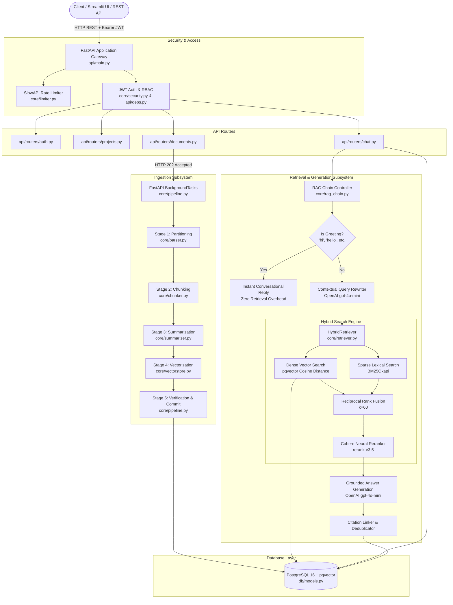
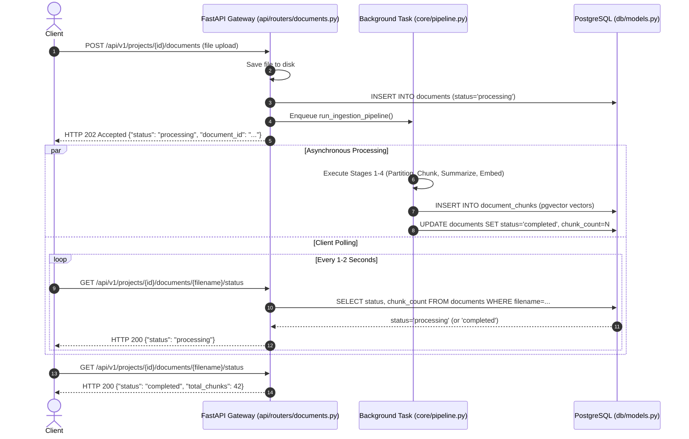
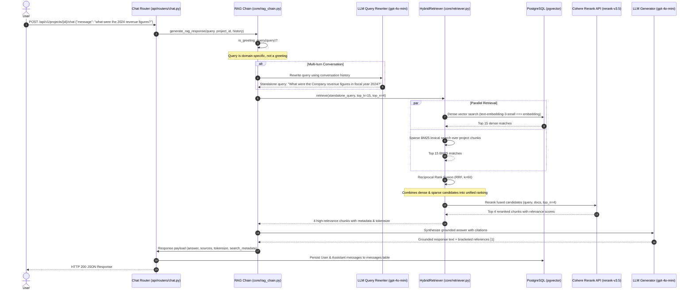

# System Workflow & Architecture

This document describes the runtime execution flows and architectural design of the Retrio RAG platform.

---

## 1. High-Level Architecture Overview

Retrio is organized into a modular layered architecture separating presentation, API routing, RAG orchestration, core processing pipelines, and native PostgreSQL storage:



---

## 2. Document Ingestion Pipeline Workflow

Document ingestion transforms raw unstructured files (PDF, DOCX, CSV, TXT, MD) into searchable semantic vectors and database records. Ingestion is executed asynchronously via FastAPI's `BackgroundTasks`.

```mermaid
flowchart TD
    A[Client Uploads File\nmultipart/form-data] --> B[Save File to Disk\ndata/projects/{id}/documents/]
    B --> C[Register Document in PostgreSQL\nstatus='processing']
    C --> D[Return HTTP 202 Accepted\nPayload with document_id and filename]
    
    subgraph Background Pipeline Task
        D -.-> E[Stage 1: Partition Document\ncore/parser.py]
        E -->|Raw Unstructured Elements| F[Stage 2: Semantic Title-Aware Chunking\ncore/chunker.py]
        F -->|Composite Chunks| G[Stage 3: Multimodal Summarisation\ncore/summarizer.py]
        G -->|Enriched Chunks with Table/Image Summaries| H[Stage 4: Vectorization & Storage\ncore/vectorstore.py]
        H -->|OpenAI text-embedding-3-small| I[Store Chunks & 1536-dim Vectors in PostgreSQL\ndocument_chunks table]
        I --> J[Stage 5: Commit & Record Pipeline State\ncore/pipeline.py]
        J --> K[Update Document Status in PostgreSQL\nstatus='completed']
    end
```

### Ingestion Stages Detailed

1. **Stage 1 — Partitioning (`core/parser.py`):**
   - Automatically detects format:
     - **PDF:** Utilizes `unstructured.partition.pdf.partition_pdf` with `strategy="fast"` (or `"hi_res"` with PDF image extraction fallback) and PyPDF fallback.
     - **DOCX / DOC:** Extracts paragraphs, formatted runs, and native document tables.
     - **CSV:** Converts tabular data into clean Markdown format for text embedding.
     - **TXT / MD:** Preserves plain text headers and code blocks.
   - Outputs: A stream of normalized `UnstructuredElement` dicts tagged with element types (`Title`, `NarrativeText`, `Table`, `Image`, `ListItem`).

2. **Stage 2 — Semantic Title-Aware Chunking (`core/chunker.py`):**
   - Implements semantic section-boundary chunking rather than naive character slicing.
   - When a `Title` or header element is encountered, a new chunk boundary is established, and the heading text is propagated down to all subordinate narrative chunks as section metadata.
   - Tables and images are treated as discrete atomic chunks to preserve structural integrity.
   - Outputs: Clean chunk objects containing `id`, `section`, `page_numbers`, `content`, `text_as_html`, and `metadata`.

3. **Stage 3 — Multimodal LLM Summarisation (`core/summarizer.py`):**
   - Inspects chunk types:
     - For `table` chunks: If HTML representation exists, prompts `gpt-4o-mini` to generate a concise semantic summary describing rows, columns, metrics, and relationships.
     - For `image` chunks: Encodes image bytes to Base64 and invokes `gpt-4o-mini` vision capabilities to describe figures, charts, and diagrams.
   - The generated summary is prepended to the chunk text or indexed as search context, enabling text search to retrieve visual and tabular data.

4. **Stage 4 — Vectorization & Database Insertion (`core/vectorstore.py`):**
   - Chunks are vectorized using OpenAI's `text-embedding-3-small` (1536 dimensions).
   - Generates deterministic UUID5 hashes based on chunk content and section to prevent duplicate insertions upon re-ingestion.
   - Inserts records directly into PostgreSQL's `document_chunks` table utilizing the `pgvector` vector extension.

5. **Stage 5 — Verification & State Transition (`core/pipeline.py`):**
   - Verifies the chunk count and vector count in the database against the chunker output.
   - Atomically updates `documents.status` from `'processing'` to `'completed'`.
   - Writes an audit checkpoint to `data/projects/{id}/documents/{filename}.pipeline.json`.

---

## 3. Background Ingestion & Status Polling Lifecycle

Because multi-page PDF parsing and vision summarisation may take 5–30 seconds, file uploads must never block HTTP threads.



---

## 4. Retrieval & Generation (RAG) Architecture

The query answering pipeline employs a multi-tiered architecture ensuring high recall, exact keyword precision, and grounded synthesis.



### Retrieval Components Detailed

1. **Meta-Greeting Interception (`core/rag_chain.py`):**
   - Matches conversational pleasantries (`"hi"`, `"hello"`, `"hey"`, `"good morning"`, `"thanks"`) using regex guardrails.
   - Checks if project has documents:
     - **With documents:** Welcomes the user and states that documents are loaded and ready for questions.
     - **Without documents:** Prompts the user to upload documents first.
   - Bypasses DB retrieval entirely, saving API latency and token cost.

2. **Conversational Query Rewriting (`core/rag_chain.py`):**
   - Resolves ambiguous conversational pronouns (e.g. *"What about its fourth quarter?"* $\rightarrow$ *"What were Apple's financial results in fourth quarter 2024?"*).
   - Prevents multi-turn degradation where retrieval fails due to unreferenced antecedents.

3. **Hybrid Search & Reciprocal Rank Fusion (RRF) (`core/retriever.py`):**
   - **Dense Retrieval:** Calculates Cosine Distance using `pgvector` (`DocumentChunk.embedding.cosine_distance(query_vector)`).
   - **Sparse Retrieval:** Executes `BM25Okapi` over in-memory tokenized project chunks to capture exact product codes, acronyms, and numeric figures.
   - **RRF Equation:**
     $$\text{RRF Score}(d) = \sum_{m \in \{\text{dense}, \text{sparse}\}} \frac{1}{60 + \text{rank}_m(d)}$$

4. **Neural Cross-Encoder Re-ranking (`Cohere rerank-v3.5`):**
   - Re-evaluates top RRF candidates using a cross-attention transformer model.
   - Returns top $N$ (default: 4) context passages with calibrated relevance scores (0.0 to 1.0).

5. **Grounded Generation & Citation Linking (`core/rag_chain.py`):**
   - Uses strict system prompts instructing `gpt-4o-mini` to answer **only** using provided context.
   - Injects structured source markers (filename, section, page numbers) to produce verifiable bracketed citations `[1]`, `[2]`.
